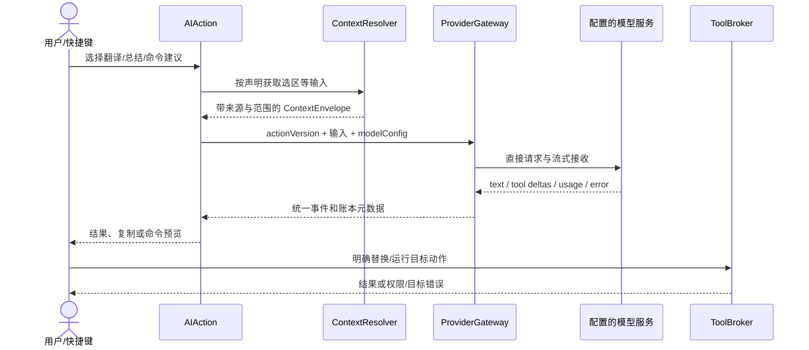
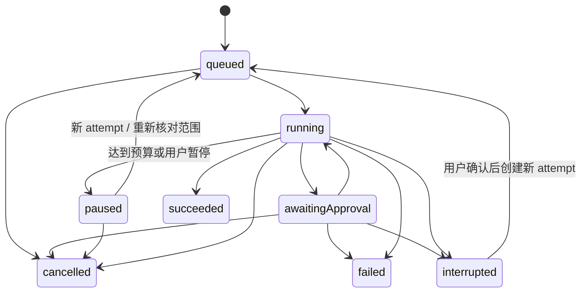

# AI、快捷动作与通用 Agent

AI 是 KeyDock 的核心能力域。首版完成外部 API 翻译/总结和命令草稿；通用 Agent 在同一模型、上下文、工具与账本基础上分阶段演进。

## 模型接入与请求链路

ProviderGateway 接受 `AIRequest(purpose, modelRef, messages, attachments, tools, limits, runID)`，返回 `AsyncThrowingStream<AIEvent>`。统一事件包括 textDelta、reasoningSummary（仅 provider 明确公开的可展示摘要）、toolCallDelta、usage、completed、failed。不能要求或持久化隐藏推理链；Agent UI 显示计划、动作和结果。

Provider adapter 实现模型目录/能力协商、认证、wire message、stream parser、错误映射和用量。能力描述覆盖 text/image、tool calls、结构化输出、streaming、context/output limits、usage availability、取消与并行工具；一个“兼容”布尔值不足以描述差异。

首期实现一个选定的公开 API adapter，提供用户自定义 endpoint 和未来本地模型接缝。请求默认由 App 直达用户选择的 endpoint，无 KeyDock 中转服务器；最终隐私声明须依据实际实现和服务商政策。Keychain 保管 key，不复制 AiBox 配置。HTTPS 默认，localhost 的 HTTP 需显式本地服务模式；跨源重定向不得转发凭证。连接/总时限、429/5xx、stream 断裂与超长输入分别处理；不默认进行隐藏付费预热。

## AIAction 与快捷键

AIAction 是版本化用户配置：ID/name、promptTemplate、inputSource、固定参数/运行参数、modelRef、输出模式、shortcut、contextScope、generation limits。普通翻译/总结 AIAction 固定 `tools=[]`；收到意外 tool-call 按协议/能力不匹配失败，不执行、不伪装成正常完成。只有 AgentRunner 消费完整 tool-call 并经 Broker。模板参数仅允许白名单；selection/clipboard/file 是带边界的输入，不将整个用户上下文拼进 system prompt。用户内容明确作为数据，不授予工具权限。

翻译动作支持目标语言、保持格式/代码段和术语偏好；总结动作支持长度、要点/行动项。默认输出到结果面板，可复制；替换选区经独立 Action 执行。无选区时展示输入选择；不得暗中扩大到整个页面或历史。用户完成第一次动作配置后，快捷键在保存范围内直接运行；模型/endpoint 或数据范围扩大时重新说明。

AX 无法读取选区时允许用户主动复制后再运行。自动模拟 Cmd+C 为后续显式 fallback：先专项 spike 确认可可靠快照和恢复的 pasteboard representations；无法快照时不承诺恢复。跟踪 changeCount，若期间外部写入则不恢复旧内容、不覆盖新剪贴板，且不能用于敏感控件。替换前重新核对应用/窗口/选区快照，目标变化时保留结果并提示；模型不能直接控制输入焦点。

长文本先估长度并告知截断/分段，不静默舍弃关键内容；分段总结需保留段来源与最终汇总口径。初期无需向量库或长期记忆。请求重试可产生额外计费，取消仅保证停止后续调用和本地流消费，不能保证服务端已终止或退款。

## 自然语言 CLI 与命令扩展

`CommandProposal` 保存 executable、argv、cwd、envRef、解释、所需资源、effects 和可读预览。模型声称的 risk 仅供显示，执行策略由宿主根据真实工具定义和目标判断。用户可修改、运行或保存为 SavedCommand；模型不得把未知工具自动注册为无条件可执行工具。

默认使用参数数组；shell 管道/重定向/替换是显式 shell mode。argv 也能调用危险工具，不能只以“不含 shell”判断安全。首期命令生成只是草稿；执行后可选择输出片段进入解释/总结动作，避免默认上传环境变量和完整日志。交互式 Agent CLI 先作为终端打开入口，后续接 PTY/ACP 才具备结构化进度。

## AgentRuntime 与统一工具边界

AgentDefinition 保存角色、模型配置、允许工具/上下文和预算；AgentRun 保存一次执行的输入版本、状态、tool invocations 与恢复位置，两者分离。

queued 可启动/取消；running 可等待授权/暂停/完成/失败/取消/中断；awaitingApproval 可继续/拒绝失败/取消/中断；paused 和 interrupted 仅经用户动作创建新 attempt 回 queued，保留旧 invocation 回执，未定副作用不重放。成功/失败/取消为该 attempt 终态，不受迟到事件修改。

Runtime 只做模型请求、解析完整工具调用、经 Broker 执行、结果回喂与停止判断。工具 schema/allowlist 冻结到 run 版本；工具更新或 MCP tool list 变化后重新评估，不能接收到远端提示就升级权限。

ToolBroker 校验 caller、schema、资源、权限/用户 grant 和预算，发出 progress/output/result。P1 用一个纯只读内置工具验证闭环；P2 增加受限工作目录内任务与窗口等明确工具。P3 才接任意外部工具提供者。

默认预算建议：每 run 最多 20 次工具调用、5 分钟墙钟时间，模型输出 token 和费用上限按 provider 可测性配置。未知费用用 token/步骤限制兜底，不显示为 0。超预算进入可见暂停状态。取消 token 贯穿模型、工具和子进程，取消后不再派发下一步。

每个有副作用的调用先写 intent，再写结果回执（invocationID、参数摘要/hash、目标、开始/完成、结果），普通 trace 不记正文。进程崩溃或网络断开后 unknown outcome 不能自动重试，要求检查；幂等纯读可按策略重试。P0 同进程；P1 提前实现最小 durable invocation receipt（开始 intent/结束 result），重启仅显示 interrupted/unknown，不自动恢复、重试或重放 CLI；P2 扩展完整 RunStore 与显式恢复，长期 helper 后续另立 change。

## MCP、ACP 与 Skills

MCPAdapter 将外部 tools/resources/prompts 映射到本地命名空间和 Broker。MCP 描述、annotations、输出和 server 日志都是不可信数据；它们不能提供授权。先支持 client；本工具对外开放 server 为独立评估项。

ACPAdapter 用于可选外部 Agent 后端的 session、权限、流式输出、取消与恢复，不等同 MCP 工具协议。Goose/OpenCode 等可作为研究或可选 adapter，核心不强依赖它们。外部 CLI/MCP server 与 App 同一用户运行时具宿主权限；独立进程只有故障隔离，不能保证其通过 Broker 才访问文件/网络。要运行不可信扩展，需额外真实沙箱/容器策略与验证。

Skills 为有版本、来源和显式启用范围的资料/提示工作流；导入文档不等于授予执行权限。首期不自动安装 marketplace 内容。参考 [MCP Swift SDK](https://github.com/modelcontextprotocol/swift-sdk)、[Goose ACP](https://goose-docs.ai/docs/oi-kit/acp/) 和 [OpenCode permissions](https://opencode.ai/docs/permissions/)，实际引入版本与许可证见参考目录。

## 使用分析与 AI 用量

两组数据独立：ActivityEvent 是 KeyDock 命令 ID、结果类别、耗时和时间；UsageObservation 是 provider、wireModelID、purpose、runID、requestID、token buckets、usage source、cost basis 与费率快照。每次真实网络请求有 attemptID，重试产生新 attempt；usage 明确 cumulative snapshot 或 delta，按 provider request/response identity 去重合并。stream 同时发 failed 并抛错也仅记一个终态，cancel/fail 保留已知部分并将未报告部分标 unknown。provider 不返回 usage 就显示 unknown；估算、影子订阅价与实际 API 费用分开，账本不等于服务商账单。

当前alpha.18实现累计快照、逐实际请求身份、可选手工输入／输出费率与原币历史分析；没有稳定eventID的delta明确拒绝并保留unknown，不能视为已经支持delta或订阅账单计价。Workflow父记录为子调用引用索引，实际只计价叶子；价格在运行准备时冻结，旧记录不追套现价，见[费用合同](ai-rate-snapshots.md)。

本地先做按日次数、耗时、失败率、热门动作和使用趋势。AIInsight 使用用户选择区间的聚合报告，附数据覆盖率/来源和依据；“建议创建某快捷动作”可审阅后一键生成草稿，不能直接修改配置或运行自动化。P4 可另行启用前台活动观察；window title、浏览 URL、键盘内容与屏幕截图绝不成为默认行为日志。

## 配置前置体验

AI动作界面与原生运行菜单使用同一配置门槛：共享实际Provider的结构验证，使用动作独立模型或全局模型；缺少有效endpoint／模型时，主动作打开AI服务设置，不新建模型任务。结构检查不读取钥匙串、不访问网络，缺密钥不代表配置无效，服务可能允许匿名。HTTPS与显式允许的loopback HTTP规则沿用Provider，不能据“配置有效”宣称已认证或联通。

CLI草稿与只读Agent辅助动作实际使用全局模型，因此独立判断全局配置，不套用当前AI动作的modelOverride。未配置时仍能输入、打开工作台、使用已授权的输入与返回草稿；运行中优先保留Stop，旧结果复制／替换继续使用原有授权，不由当前配置反向剥夺。打开设置或保存配置不会自动提交输入。
