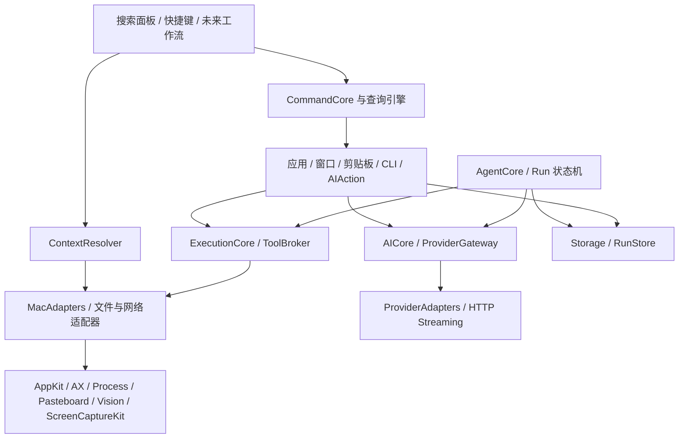

# 系统架构 v0.1

状态：设计基线与第一阶段实现并行演进，具体进度见 docs/implementation/phase-one-progress.md。采用原生 macOS 模块化单体，Swift 6 + AppKit/SwiftUI；暂定 macOS 14+。先用单 App 进程与可替换适配器，实际需要时再引入 helper，不提前搭后台 daemon、云服务或插件 UI runtime。

## 模块与依赖

App 是组合根，持有服务生命周期和依赖注入；上图是运行链路，不表示下层可反向 import 上层。计划包层次：

| 层 | 模块 | 约束 |
|---|---|---|
| T0 纯核心 | CommandCore、ExecutionCore、AICore | Foundation + Sendable 值模型，不依赖 AppKit/数据库/厂商 SDK |
| T1 编排 | SearchEngine、AgentCore、InsightCore | 依赖 T0，通过协议接触存储、工具和模型 |
| T2 适配 | MacAdapters、ProviderAdapters、Storage、MCPAdapter/ACPAdapter | 实现 T0/T1 的 host seams，依赖官方框架/审查后的库 |
| T3 功能 | LauncherFeature、ClipboardFeature、CLIWorkbench、AIActionFeature、AgentWorkspace | 使用公开协议，UI 与业务可分别测试 |
| T4 壳 | KeyDockApp | AppKit Panel、菜单栏、设置和组合根，不承载业务实现 |

当前根 Package.swift 定义 CommandCore、ExecutionCore、AICore、AgentCore、MacAdapters、KeyDockUI、WorkbenchFeature 多个 target，源代码位于 Packages/<Module>；App 薄壳位于 Apps/KeyDock，XcodeGen 生成原生 App 工程。Storage 已在 MacAdapters 内先实现 SQLite 剪贴板和私有文件适配；纯核心没有反向依赖 App。桌面启动、窗口切换、网络、命令执行和结果操作已接入共用 ExecutionPolicy，按 caller、版本、资源、effects、有效期做边界检查；只读 ToolBroker 使用同一策略，仍不等同 OS sandbox。三窗口和共享文档／会话状态详见 [UI架构](ui-architecture.md)。

## 核心契约

| 合同 | 必要字段/行为 |
|---|---|
| CommandDescriptor | namespaced ID、版本、标题/关键词、输入/输出类型、provider、可用性、上下文声明、执行引用 |
| QueryRequest / ResultBatch | queryID/generation、文本/模式、时间、来源、稳定对象 ID、排序依据、partial/complete、diagnostic |
| ActionDescriptor | 输入 schema、effects、所需能力、目标资源、是否可撤销、幂等性类别、结果动作 |
| ExecutionRequest | invocationID、caller=user/shortcut/agent/workflow、command/tool ID、validated arguments、target snapshot、policy grant |
| ContextEnvelope | 来源/类型、采集时间、目标 identity、敏感度、有效期、用户选择范围；内容通过受控 handle 读取 |
| ExecutionEvent | queued/running/progress/output/awaitingApproval/succeeded/failed/cancelled/interrupted，结果类型和脱敏错误 |
| ToolDefinition | schema version、参数/结果 schema、effects、host implementation；权限由 Broker 校验 |

命令目录与工具目录分别投影同一能力。允许同一实现供 UI 和 Agent 使用，不把整个搜索目录无条件暴露给模型；通过 tool allowlist 和 caller policy 限定。

## 搜索与 UI 生命周期

Panel 在主线程显示；应用/窗口索引更新与查询重计算离主线程。查询按 generation 并行 fan-out，各 Provider 独立限时并增量返回，结果合并使用稳定 ID。新查询取消旧任务，UI 仅接受当前 generation；慢 AI、网络或文件搜索不能阻塞本地应用结果。

排序先用确定性的前缀/词匹配、别名、收藏、最近使用；保留评分解释，先测中文/拼音/英文任务集再决定引入 fuzzy/pinyin 库。当前不承诺语义搜索默认参与每次输入。

唤起前保存 frontmost application、focused window 与 selection hint；Panel 自己不能覆盖原目标。IME 组合输入不派发执行。Esc 退出恢复有效原目标；执行切换时目标就是新窗口，不再强制回旧窗口。结果和长任务可固定到独立任务区，Panel 收起不等于取消。

## 执行与 OS 适配

ToolBroker 按参数 schema、调用者、resource scope、OS permission、用户 grant 和执行预算逐层检查，dispatch 后跟踪事件。原生工具通过受控适配器访问资源；第三方进程的宿主权限另见数据策略，不能宣传 broker 等于 OS sandbox。

窗口使用 application/process/window 的复合 identity 与生命周期校验，PID 不作为唯一窗口 ID。可选 window number/AX 引用只在可获得且新鲜时使用，失效即重新解析；不持久化可复用 PID 作为授权。几何使用每屏 visible frame、坐标变换和窗口 min/max constraints；恢复按窗口保存，屏幕改变后 clamp。只用公开 API，跨 Space/fullscreen 行为逐系统实测，不能承诺系统不支持的强制移动。

CLI 分成一次性 Process、终端打开、后续 PTY 三种 adapter。argv 不拼 shell 字符串；用户明确 shell mode 时才交解释器。输出双流读取消除阻塞，有上限与截断标记；取消管理子进程生命周期，不能只取消 Swift Task。配置 PATH 显式，不默认读取/执行用户 login profile。

## 架构决策记录

| ADR | 决定与理由 | 替代方案/代价 |
|---|---|---|
| 001 | 原生 AppKit Panel + SwiftUI 内容，适配焦点/快捷键/AX | Electron/RN 可共享 UI，但当前不需要跨平台 runtime；原生也需处理 Panel 生命周期 |
| 002 | 模块化单体 + host seams，减少部署与调试负担 | daemon/微服务推迟到持久后台任务确有需求时 |
| 003 | Command/Tool 共用执行服务，搜索与 Agent 解耦 | 每功能独立执行会重复权限、取消和审计 |
| 004 | AI action 直调 gateway；Agent 只用于多步工具编排 | 所有翻译都跑 agent 会增加成本和失败面 |
| 005 | 新定义小合同，先参考 AiBox 语义 | 整包迁移耦合、许可和私有数据风险高；可抽取模块后再评估 |
| 006 | 直接分发路线优先，Developer ID + 公证 | Mac App Store/App Sandbox 可行性需专项 spike，不宣称已支持 |
| 007 | references 只含固定 SHA 和研究笔记 | 不 vendor 完整参考仓、不要 submodule 带入大量无关代码 |

[App Sandbox](https://developer.apple.com/documentation/xcode/configuring-the-macos-app-sandbox) 是 Apple 强制的资源隔离机制之一，Mac App Store 要求启用；是否适合本工具需结合实际能力验证。[ScreenCaptureKit](https://developer.apple.com/documentation/screencapturekit) 用于用户触发的屏幕输入，[SMAppService](https://developer.apple.com/documentation/servicemanagement/smappservice) 用于后续用户启用的登录项，均不作为首启必需授权。
