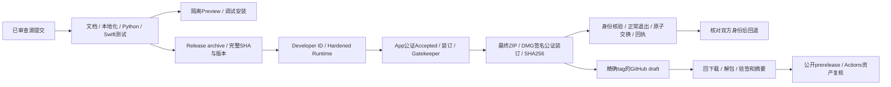

# 构建、调试、安装与发行流水线

2026-11-23。统一入口为 `python3 scripts/keydock.py`，Makefile提供短命令；Python3.9+标准库、Xcode27.2、XcodeGen、Git与GitHub CLI即可运行。版本／build、架构、bundleID、签名team与目标仓库由 [release/config.json](../../release/config.json)管理。

2026-11-25个人Mac补充：统一CLI在共享`build_storage.py`存在时自动包裹整个命令，包括release内的检查／构建／导出／安装／上传及回执；已持有外层租约时仍经共享工具验证后复用。可用`PERSONAL_BUILD_STORAGE_TOOL`指定治理器，显式配置缺失时失败，不转未包裹编译器。其他开源开发机及CI未部署此个人工具时保留原工程容量检查。

通用Swift／iSpec原生命令须在整段外层使用`python3 /Users/ai/project/_workspace/tools/build_storage.py run --source-root <canonical> --expected-gib N -- COMMAND ARG`。日常目标200 GB、物理硬底线120 GiB，按status的活跃预留和buildHeadroomGiB准入；当前KeyDock为admission-only，不自动扩大清理白名单。复用固定缓存，保留最新两份完整原始发行和引用中的失败证据，结束记录源身份／退出状态／证据位置并仅收尾任务自有scratch。空间治理与产品验收分别报告。

## 工程入口

| 命令 | 行为 |
|---|---|
| `make doctor` | 版本、Git状态、工具与公证profile是否配置，不读取凭据正文 |
| `make check` | 分支、文档、本地化、Python流水线边界、Swift测试与lifecycle helper编译 |
| `make performance` | Release合成查询原始样本与50ms预算；自有进程采样见[性能采样](performance-sampling.md) |
| `make debug` | 构建隔离Preview，正常退出旧Preview，原子替换到用户Applications并启动 |
| `make desktop-fixture` | 构建独立的三个合成文本窗口宿主，保留全新App与收据，不启动、不替换生产数据 |
| `make build` | 只构建允许WIP的Preview |
| `KEYDOCK_NOTARY_PROFILE=<profile> make release` | 干净提交的Release archive、签名、公证、装订、Gatekeeper与最终资产 |
| `make install` | 核验当前版本包的ZIP／DMG同源同字节App后安装至 `/Applications/KeyDock.app`，保留旧App与回退凭据 |
| `make rollback RECEIPT=<receipt.json>` | 核对当前包／备份，正常退出目标后回退 |
| `make publish` | 核对源／master可达性／tag，补齐draft，回下载通过后公开 |
| `make verify-release` | 下载当前版本，核对摘要、tag、实际签名／公证与Gatekeeper |

check与build要求工程所在卷至少2GiB可用空间，doctor的buildStorage返回实际值与准备状态。容量不足时在编译前失败，check仍记录失败attempt；不会自动删除缓存、修改源码或复用该次失败为发行资格。临时调试缓存只能在确认无本工程活动构建后按准确目录清理，保留发行资产、回退包和验证证据。

`python3 scripts/keydock.py release --install --publish`可组合正式流程。首次开源先建立并核对仓库、受控fast-forward并推送master与tag；发布入口不会隐式创建tag或修改分支。每步退出码、耗时和日志留在忽略的 `.local/pipeline/<run>/`；package／publish可独立重试。已存在版本只复用相同源和摘要；签名时间戳会使重复构建字节不同，不承诺逐位可复现。

公证／打包中断按[冻结候选与公证恢复](release-candidate-recovery.md)处理。`.local/release-delivery`和被引用candidate是协议状态，不能当可重建缓存清理；package默认继续原候选，unknown无ID不自动重投。已Accept的输入不修改，装订在独立副本进行。

Swift检查采用互补独立阶段：主体、Terminal生命周期和生产Vision OCR。原有两秒退出／回执时限断言不变；完整本机任一阶段失败或没有匹配用例都会停止。`--jobs 2`仅限制构建并发，不会串行Swift Testing的MainActor套件；拆分避免大批合成磁盘／主线程工作污染时间测量，不表示繁忙系统具备硬实时保证。完整本机合并覆盖全部Swift用例，云端scope另行标识，禁止失败后自动fallback或重试变绿。

从alpha.4起，测试清单分为core、Terminal和生产Vision OCR三个互补分区，发现的清单必须包含精确OCR用例，分区非空且无遗漏。参数化用例使执行数量可高于声明数量。云端`check --ci`仅运行前两个分区，summary明确`system OCR: NOT_QUALIFIED`；此前VM上的真实OCR错误保留，不宣称云端识别通过。完整本机check还必须独立运行生产OCR，先在新测试进程提取，再重复提取同一合成PNG；校验accurate／revision3／自动语言／纠正／支持CPU设备配置和实际识别结果。该阶段180秒超时即失败，只结束其独占验证进程组。

干净源的完整检查生成受控资格回执，绑定完整SHA、version/build、实际系统／芯片／工具链、测试清单摘要、生产代码／资格测试／门禁源码摘要、图片摘要及每轮判定、各阶段原始日志摘要。App BuildInfo包含资格摘要；schema2发行manifest携带对应资格和同SHA的指定push core CI记录。构建、打包、既有DIST重用、publish均重读实际本机日志和源码核对；回下载再验证App摘要、tag源文件和指定CI结果。缺资格、云端scope、模式不符、漏OCR、失败／超时、源变化或日志被改都会拒绝。摘要用于绑定证据，不是硬件远程证明；实际系统与更广产品验收仍分别报告。alpha.1／alpha.2原资产继续按旧schema复核；未公开的alpha.3候选保留原字节，不补造新资格。

Release构建前后还比较资格与当前OS build／Swift／完整Xcode及SDK版本。完整clean检查记录running／failed／passed，后续失败或未结束会阻止继续消费历史PASS；新完整PASS后才恢复。资格锚点和对应原日志须保留，重复同源检查不会覆盖已装入不可变包的摘要。ZIP与DMG不仅验签：DMG只读／nobrowse挂载到独占目录，核对内部App的源、版本、build、资格及整个bundle摘要与ZIP一致，再精确正常卸载；不选择用户现有卷、不force detach。`make install`消费已核验发行包，避免误装build目录里残留的旧候选；旧alpha.3缺资格，默认安装拒绝。

alpha.24配置reader为[1,2,3]、writer为[3]；旧包副本即使验签成功，也不能在配置升级到3后无条件回退。配置probe包含null待迁移状态，安装／回退在替换前拒绝不兼容reader，原数据保留。

普通隔离Preview的`native-review`应显式复用同一owned fixture并用进程回执确认正常退出；不要对已退出App再调用会选择／启动App的UI入口来“证明退出”。alpha.24复查在退出后AX读取序列中观察到额外默认Preview启动，已正常收口且不纳入资格，未唯一归因底层机制。当前复用root的`review-process.json`更新为最新运行，重启前应保留当次观察；逐次不可覆盖的运行回执仍列入后续调试工程。独立DesktopReview继续使用其独立launch receipt及窄scope，不能将普通Preview当作等价权限入口。

各阶段均显式传入`--no-parallel`，因为CLI帮助中的默认值未让Swift Testing顶层套件串行。集成夹具的合成进程startup／cleanup含同步poll／usleep，并发时会延迟另一套件的SSE消费，导致五秒drain时限误触发。明确串行后日志按套件顺序执行；应用任务的五秒drain、输出上限、真实进程／网络和全部断言保留。隔离Python合成服务使用`-I -S`，准备就绪预算20秒，不占用应用任务断言的时间。

`gh workflow run ci.yml --ref <已推送功能分支> -f diagnose_ocr=true`只运行独立的OCR诊断job，不替代native验收，也不会取消该分支的native job。探针`Tools/Fixtures/vision_diagnostic.swift`只生成自己的同一张合成PNG，准确模式场景分别使用自动语言、英语、两种中英顺序、无语言纠正、旧公共CPU标志和revision2；每场景独占子进程45秒时限，记录设备／revision／原始NSError及PNG摘要。识别错误、超时或结果不匹配返回非零，artifact照常保留，不回退fast，也不读取个人文件或下载模型。诊断工具允许旧公共CPU标志的弃用警告，产品不因此使用旧标志或更改准确模式；`--only <scenario>`可只运行一个已登记场景。

发行后的证据文档可以追加提交，发行tag仍固定在原始构建源。复核已有版本使用`make verify-release`；再次发行先更新version／build，不从新HEAD覆盖旧版本。若确需重试未完成的同版发布，先回到对应干净源提交。

## 调试与正式身份

| 项目 | Preview | 正式身份 |
|---|---|---|
| bundleID | com.arthurwangwsx.KeyDock.preview | com.arthurwangwsx.KeyDock |
| 安装位置 | 用户Applications中的KeyDock Preview.app | /Applications/KeyDock.app |
| 构建 | DebugPreview；CI用ReleasePreview优化 | Release archive |
| 上下文／凭据 | SafeSmoke隔离数据，停用真实采集、权限请求和凭据存储 | 按配置与系统权限按需启用，剪贴板默认关闭 |
| 信任 | 明确隔离的本地ad-hoc预览 | 项目Developer ID team、runtime、公证装订和Gatekeeper |

`python3 scripts/keydock.py install --app <App> --dry-run`检查并报告目标／备份／退出计划，不替换或退出App；wrapper可能先编译工程helper。`--quit-running`请求准确路径的App正常退出，取消其可取消任务并结束内存会话，不能宣称未保存正文已持久化。未知同bundleID进程整批拒绝；20秒超时停止，不force kill。

Debug使用单一可执行文件（`ENABLE_DEBUG_DYLIB=NO`），保留Hardened Runtime；避免Xcode未统一签名的debug dylib在安装后触发库验证失败。此路径覆盖构建、安装和UI／日志调试；Xcode／LLDB断点与附加权限尚待专项验收。

合成原生复查使用`python3 scripts/keydock.py native-review`（先构建Preview）；它创建`.local/desktop/KeyDock-Review-UUID`及private marker，等待GUI正常退出并保存进程回执。`--fixture <上次目录>`复用同一owned域供重启验证。只有Preview编译／SafeSmoke／BuildInfo preview接受显式根，runner在写日志前检查owner／marker，日志拒绝symlink和多hardlink。系统Foundation临时目录在本机不随gate TMPDIR变化，不能再以继承环境推断隔离成功；正式／普通Preview默认域与安装器定位不受此入口影响。

alpha.19候选增加签名BuildInfo／manifest数据能力声明与安装／回退门禁。正常退出后持有runtime-owner lease，检查三个固定Invocation Envelope及目录映射，交换和失败补偿均重新验证。已知旧alpha.1–18缺省为read/write v1，未知缺声明拒绝；生成v2后旧alpha.18回退被拒绝并保留App和数据。二进制备份不等于可读数据恢复，跨版本archive／restore尚未实现；手动覆盖和历史脚本不在新门禁范围内。

安装器完成路径／重叠／身份／进程预检后才按显式参数创建父目录，再在目标同卷复制并验证资源与权限摘要，使用macOS renamex_np原子交换；首次安装使用EXCL拒绝后来出现的目标。旧App保存在回执指定的隐藏备份路径，不自动删除。回退再次检查真实签名team与双方摘要，退出等待后重新核对目标；无法确认时保留双方和needs-recovery回执。不改用户配置、Keychain、TCC或quarantine，不自动授予AX权限，不使用sudo。

## 发行与CI

正式App嵌入干净完整SHA、版本/build、profile、架构与工具链。签名和公证仅引用系统已有身份／Keychain profile。App公证Accepted后装订，ZIP取装订后的App；DMG另行签名、公证和装订。最终摘要完成后，只上传ZIP、DMG、release-manifest.json与SHA256SUMS.txt；已有不同字节的资产不clobber。Release说明保留物理交互、最低系统、真实模型等未验项。

CI使用GitHub官方 [`xcode-27` arm64 image](https://github.com/actions/runner-images)，显式选择Xcode27.2；runner目前为public preview，实际远端结果单独记录。PR/master保持contents: read，运行共用check与隔离Preview构建；签名凭据留在本机。公开后release-audit工作流再次下载并验签／验摘要。Actions固定经核对的完整commit SHA。[文档工作流](../../.github/workflows/docs.yml)继续快速反馈。

参考 [Apple命令行公证](https://developer.apple.com/documentation/security/customizing-the-notarization-workflow)和[GitHub Release CLI](https://cli.github.com/manual/gh_release_create)。工程思路参考本机DevSpace的来源绑定、公证、摘要与回下载；使用KeyDock自己的源码仓与身份配置。

原生CI成功和失败均保留该VM上的合成验证日志7天；失败摘要优先输出具体测试错误，再保留末尾上下文。日志artifact与隔离Preview各自独立，公开Release使用固定四项资产清单。
