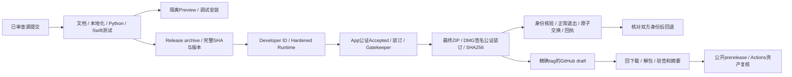

# 构建、调试、安装与发行流水线

2026-11-23。统一入口为 `python3 scripts/keydock.py`，Makefile提供短命令；Python3.9+标准库、Xcode27.2、XcodeGen、Git与GitHub CLI即可运行。版本／build、架构、bundleID、签名team与目标仓库由 [release/config.json](../../release/config.json)管理。

## 工程入口

| 命令 | 行为 |
|---|---|
| `make doctor` | 版本、Git状态、工具与公证profile是否配置，不读取凭据正文 |
| `make check` | 分支、文档、本地化、Python流水线边界、Swift测试与lifecycle helper编译 |
| `make debug` | 构建隔离Preview，正常退出旧Preview，原子替换到用户Applications并启动 |
| `make build` | 只构建允许WIP的Preview |
| `KEYDOCK_NOTARY_PROFILE=<profile> make release` | 干净提交的Release archive、签名、公证、装订、Gatekeeper与最终资产 |
| `make install` | 正式App安装至 `/Applications/KeyDock.app`，保留旧App与回退凭据 |
| `make rollback RECEIPT=<receipt.json>` | 核对当前包／备份，正常退出目标后回退 |
| `make publish` | 核对源／master可达性／tag，补齐draft，回下载通过后公开 |
| `make verify-release` | 下载当前版本，核对摘要、tag、实际签名／公证与Gatekeeper |

`python3 scripts/keydock.py release --install --publish`可组合正式流程。首次开源先建立并核对仓库、受控fast-forward并推送master与tag；发布入口不会隐式创建tag或修改分支。每步退出码、耗时和日志留在忽略的 `.local/pipeline/<run>/`；package／publish可独立重试。已存在版本只复用相同源和摘要；签名时间戳会使重复构建字节不同，不承诺逐位可复现。

发行后的证据文档可以追加提交，发行tag仍固定在原始构建源。复核已有版本使用`make verify-release`；再次发行先更新version／build，不从新HEAD覆盖旧版本。若确需重试未完成的同版发布，先回到对应干净源提交。

## 调试与正式身份

| 项目 | Preview | 正式身份 |
|---|---|---|
| bundleID | com.arthurwangwsx.KeyDock.preview | com.arthurwangwsx.KeyDock |
| 安装位置 | 用户Applications中的KeyDock Preview.app | /Applications/KeyDock.app |
| 构建 | DebugPreview；CI用ReleasePreview优化 | Release archive |
| 上下文／凭据 | SafeSmoke隔离数据，停用真实采集、权限请求和凭据存储 | 按配置与系统权限按需启用，剪贴板默认关闭 |
| 信任 | 明确隔离的本地ad-hoc预览 | 项目Developer ID team、runtime、公证装订和Gatekeeper |

`python3 scripts/keydock.py install --app <App> --dry-run`检查并报告目标／备份／退出计划，不替换或退出App；wrapper可能先编译工程helper。`--quit-running`请求准确路径的App正常退出，取消其可取消任务并结束内存会话，不能宣称未保存正文已持久化。未知同bundleID进程整批拒绝；20秒超时停止，不force kill。

Debug使用单一可执行文件（`ENABLE_DEBUG_DYLIB=NO`），保留Hardened Runtime；避免Xcode未统一签名的debug dylib在安装后触发库验证失败。此路径覆盖构建、安装和UI／日志调试；Xcode／LLDB断点与附加权限尚待专项验收。

安装器完成路径／重叠／身份／进程预检后才按显式参数创建父目录，再在目标同卷复制并验证资源与权限摘要，使用macOS renamex_np原子交换；首次安装使用EXCL拒绝后来出现的目标。旧App保存在回执指定的隐藏备份路径，不自动删除。回退再次检查真实签名team与双方摘要，退出等待后重新核对目标；无法确认时保留双方和needs-recovery回执。不改用户配置、Keychain、TCC或quarantine，不自动授予AX权限，不使用sudo。

## 发行与CI

正式App嵌入干净完整SHA、版本/build、profile、架构与工具链。签名和公证仅引用系统已有身份／Keychain profile。App公证Accepted后装订，ZIP取装订后的App；DMG另行签名、公证和装订。最终摘要完成后，只上传ZIP、DMG、release-manifest.json与SHA256SUMS.txt；已有不同字节的资产不clobber。Release说明保留物理交互、最低系统、真实模型等未验项。

CI使用GitHub官方 [`xcode-27` arm64 image](https://github.com/actions/runner-images)，显式选择Xcode27.2；runner目前为public preview，实际远端结果单独记录。PR/master保持contents: read，运行共用check与隔离Preview构建；签名凭据留在本机。公开后release-audit工作流再次下载并验签／验摘要。Actions固定经核对的完整commit SHA。[文档工作流](../../.github/workflows/docs.yml)继续快速反馈。

参考 [Apple命令行公证](https://developer.apple.com/documentation/security/customizing-the-notarization-workflow)和[GitHub Release CLI](https://cli.github.com/manual/gh_release_create)。工程思路参考本机DevSpace的来源绑定、公证、摘要与回下载；使用KeyDock自己的源码仓与身份配置。

原生CI成功和失败均保留该VM上的合成验证日志7天；失败摘要优先输出具体测试错误，再保留末尾上下文。日志artifact与隔离Preview各自独立，公开Release使用固定四项资产清单。
