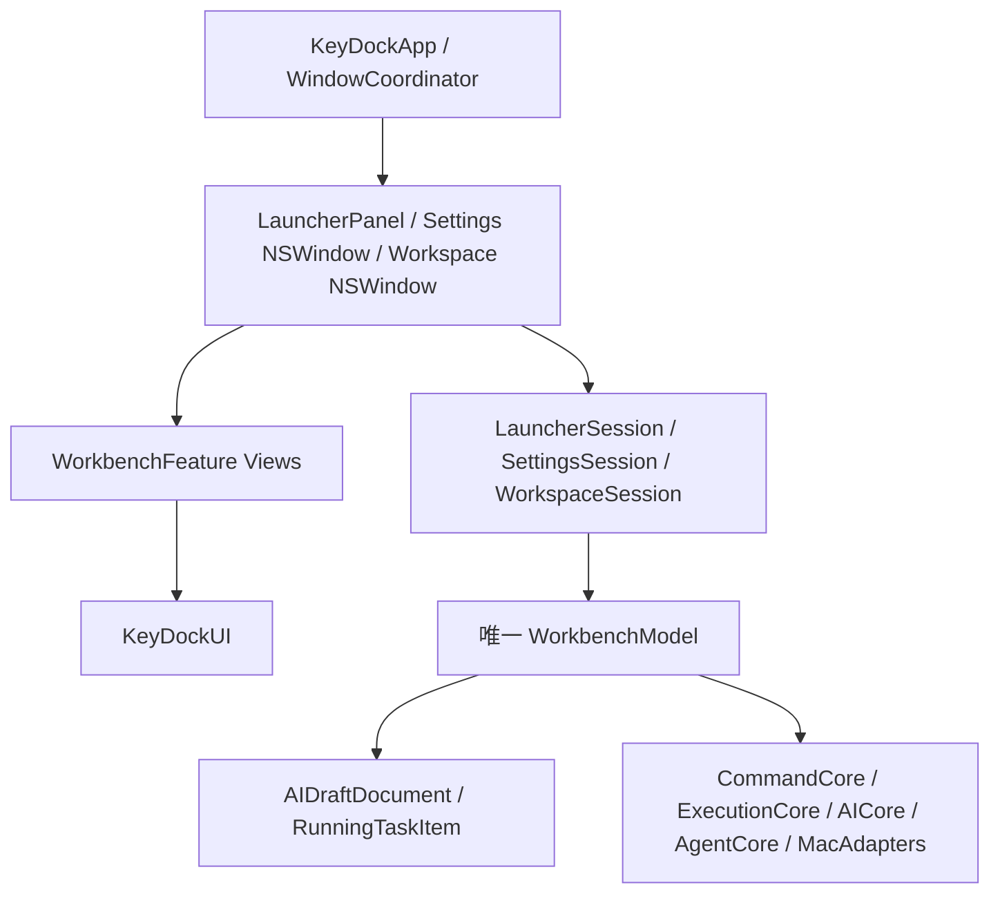

# UI 架构与组件库

2026-11-22。实现路径为原生模块化单体，UI 不引入 Web runtime 或第三方主题框架。

## 状态所有权

| 对象 | 拥有状态 | 不拥有 |
|---|---|---|
| WindowCoordinator | 窗口、菜单、快捷键、展示 generation、原目标快照捕获 | 模型请求与进程执行实现 |
| LauncherSession | 查询、结果选择、焦点请求、动作菜单、当前草稿引用 | 设置表单和任务生命周期 |
| SettingsSession | 分类、命令／动作编辑 sheet、服务草稿与未保存 key、待审建议队列 | AI 输入和工作区路由 |
| WorkspaceSession | 当前页、任务选择、剪贴板查询、草稿引用 | 设置表单 |
| WorkbenchModel | 配置、能力目录、服务、任务、文档注册表、运行与目标映射 | 窗口搜索／选择／导航 |
| AIDraftDocument | input、actionID、revision、输入来源与原目标、latestRunID、提示 | 任意新前台窗口的可变选区 |
| RunningTaskItem | runID、运行时标题／模型／来源、状态、输出、结果提示 | 当前设置中的可变模型名 |

长任务与窗口生命周期解耦；窗口关闭不取消，App 正常退出则等待受控取消。结果按 runID 查找，原目标按结果保存；只因当前窗口切换不能扩大替换权限。配置保存、运行失败和草稿提示分别归属，避免跨窗口旧消息。

## KeyDockUI

独立 SwiftPM library，依赖 AppKit／SwiftUI，不依赖业务模块。包含 KDTokens、KDLauncherSurface、KDSearchField、KDCommandRow、KDKeycap、KDIconButton、KDEmptyState、KDInlineNotice 与跨 bundle 的 KDLocalizer。可复用组件只接受展示数据和回调，文案与业务动作由 Feature 提供。

材质选择集中在 KDLauncherSurface：26+ NSGlassEffectView，27+ effectIsInteractive，旧系统 NSVisualEffectView，减少透明度采用不透明表面。SwiftUI 原生侧栏／工具栏／表单由当前 SDK 和系统绘制。UI 线程仅处理布局与状态，排序通过 detached Task；慢网络、AX 捕获和进程流不在 View body 运行。

## 本地化约定

Feature 与 App 各自处理 xcstrings，调用 L／AppL；KeyDockUI 不保存业务文案。`scripts/update-localizations.py --check` 验证两个 bundle 的英中 key 覆盖。设置保存语言后更新 Store、菜单标题和环境 locale，原生 NSTextField 同步更新 placeholder 与 accessibility label。任务状态与内置动作按 key 运行时翻译；用户数据不作为文案 key。

## 继续拆分边界

当前 WorkbenchFeature 包含 View 与应用服务编排，适合首阶段小团队；后续功能增多时按 Launcher／Settings／Clipboard／AIWorkspace 拆 feature target，保持 Store 接口和文档引用合同。不允许基础模块反向 import UI；插件通过命令／工具合同接入，不直接操纵任意窗口状态。

验证包含纯模型／配置迁移、窗口会话隔离、草稿版本、键盘导航和实际系统截图。编译成功仅证明 API／类型兼容，不证明材质、布局或系统焦点通过验收。
