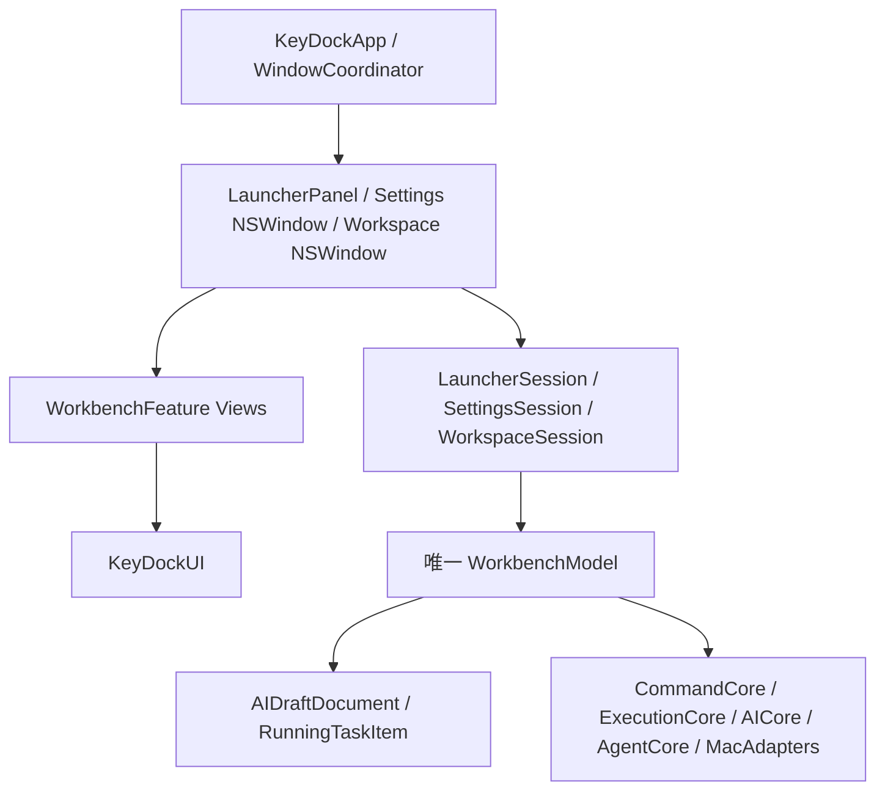

# UI 架构与组件库

2026-11-23。实现路径为原生模块化单体，UI 不引入 Web runtime 或第三方主题框架。

## 状态所有权

| 对象 | 拥有状态 | 不拥有 |
|---|---|---|
| WindowCoordinator | 窗口、菜单、快捷键、展示 generation、原目标快照捕获 | 模型请求与进程执行实现 |
| LauncherSession | 查询、结果选择、焦点请求、动作菜单、当前草稿引用 | 设置表单和任务生命周期 |
| SettingsSession | 分类、命令／动作编辑 sheet、服务草稿与未保存 key、当前审阅表单/来源ID | AI 输入和工作区路由 |
| WorkspaceSession | 当前页、任务选择、ClipboardBrowserSession、草稿引用 | 设置表单与全量剪贴板正文 |
| ClipboardBrowserSession | 查询generation、轻量预览、单项详情、变更通知 | 共享业务任务和持久配置 |
| WorkbenchModel | 配置、能力目录、服务、任务、文档注册表、运行与目标映射 | 窗口搜索／选择／导航 |
| AIDraftDocument | input、actionID、revision、输入来源与原目标、latestRunID、提示 | 任意新前台窗口的可变选区 |
| RunningTaskItem | runID、运行时标题／模型／来源、状态、输出、结果提示 | 当前设置中的可变模型名 |

长任务与窗口生命周期解耦；窗口关闭不取消，App 正常退出先同步设置围栏与取消可取消的工作，再等待任务和回执收尾；已提交的Terminal交接不可撤回，有界等待后显示unknown。启动台选择与滚动请求分离：悬停只改选择，键盘导航或结果回退才请求滚动，避免静止鼠标引发列表连续跳动。结果按 runID 查找，原目标按结果保存；只因当前窗口切换不能扩大替换权限。配置保存、运行失败和草稿提示分别归属，避免跨窗口旧消息。

## KeyDockUI

独立 SwiftPM library，依赖 AppKit／SwiftUI，不依赖业务模块。包含 KDTokens、KDLauncherSurface、KDSearchField、KDCommandRow、KDKeycap、KDIconButton、KDEmptyState、KDInlineNotice 与跨 bundle 的 KDLocalizer。可复用组件只接受展示数据和回调，文案与业务动作由 Feature 提供。

材质选择集中在 KDLauncherSurface：26+原生SwiftUI glassEffect regular／interactive，减少透明度动态切换identity与系统实色；旧系统使用NSVisualEffectView。hosting和输入前景保持身份，背景参数变化不重建焦点树；减少动态效果关闭交互和动画。应用外观可跟随系统或选择浅／深色，由NSApp.appearance统一应用。标准侧栏／工具栏／表单由当前SDK与系统绘制。Launcher通过CatalogProvider→QueryCoordinator actor接收携带完整QueryRequest的ResultBatch，排序离主线程；慢网络、AX与进程流不在View body运行。

剪贴板全文搜索在数据库 actor 运行，列表只接收受字节数和字符数限制的预览；明确预览／复制时才读取单项正文。行使用独立可访问按钮，查询和单项预览分别以 generation 拒绝迟到结果，数据库变更不重置窗口查询。

## 快捷键与迟到交互

快捷键配置由同一ShortcutPlan投影：Carbon注册层整组替换，传输token与持久动作ID分离，每次注册使用新token。设置先验证系统注册再写私有配置，失败分别补偿文件与OS，无法完整恢复时明确告警；注册恢复失败停用并提供重试。录制结束后才提交候选，保存失败保留AI动作草稿。已绑定动作始终可见，不可用目标保留清理入口；“已向macOS注册”仅表示系统接受注册，不等同物理按键、IME和全屏验收。

应用启动先后台打开，PreparedApplicationLaunch仅提供后续激活；Store在同一交互generation仍有效时激活并收起Panel。新presentation、真实query编辑、dismiss和新动作使旧回调失效；配置/目录重搜不失效。等待选区捕获的动作在登记pending意图时就失效旧回调，不能等真正dispatch。

AIUsageStatusView由AI结果和任务详情复用；事实聚合继续使用AICore accumulator，缺报Agent轮次通过独立usageUnknown事件标记，不生成虚假的提供商观察。恢复只异步读取有界元数据，缺失/损坏保持unknown；不会加载正文或创建请求。

## 本地化约定

Feature 与 App 各自处理 xcstrings，调用 L／AppL；KeyDockUI 不保存业务文案。`scripts/update-localizations.py --check` 验证两个 bundle 的英中 key 覆盖。设置保存语言后更新 Store、菜单标题和环境 locale，原生 NSTextField 同步更新 placeholder 与 accessibility label。任务状态与内置动作按 key 运行时翻译；用户数据不作为文案 key。

## 继续拆分边界

当前 WorkbenchFeature 包含 View 与应用服务编排，适合首阶段小团队；后续功能增多时按 Launcher／Settings／Clipboard／AIWorkspace 拆 feature target，保持 Store 接口和文档引用合同。不允许基础模块反向 import UI；插件通过命令／工具合同接入，不直接操纵任意窗口状态。

验证包含纯模型／配置迁移、窗口会话隔离、草稿版本、键盘导航和实际系统截图。编译成功仅证明 API／类型兼容，不证明材质、布局或系统焦点通过验收。

提案队列由Store持有runID与预算，待审和正在审阅合计最多10份，进入设置表单后仍保留源数据记账。窗口通过可见引用保护草稿和当前结果；清除成功联动移除窗口引用、复制标记与来源。新编辑用revision保留，历史和用量各用generation拒绝迟到恢复；定时维护不依赖恢复快照是否过时。
